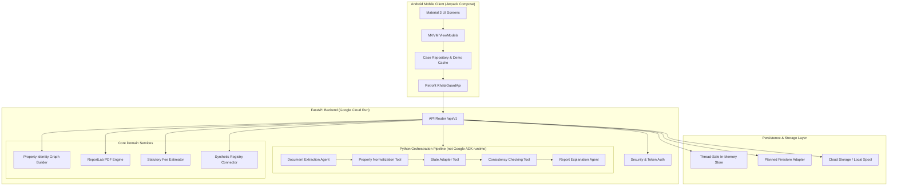

# KhataGuard AI — Architectural Design Document

**Author**: Team SwagCoders  
**Context**: Google DeepMind × Google Cloud Startup Buildathon India 2026  
**Status**: Local demo MVP; cloud and Firebase components below are planned interfaces unless stated active

---

## 1. Architectural Philosophy

Indian property records are governed by a federated system of state registration departments, municipal urban bodies, and revenue departments. KhataGuard AI is engineered around four core principles:

1. **State-Adaptive Extensibility**: Documents, terminology, statutory registries, and mandatory checks vary by state. Instead of hardcoding logic, a modular State Adapter architecture isolates jurisdictional nuances.
2. **Deterministic Rules Over Generative Arithmetic**: LLMs excel at multilingual unstructured text extraction; they are fundamentally untrustworthy for exact land area conversions, threshold comparisons, and surveyor arithmetic. All cross-document consistency checks are executed by unit-tested Python functions.
3. **Property Identity Graph**: Documents represent transactions, not the underlying property. The Property Identity Graph synthesizes disparate documents into a unified topological network of owners, survey parcels, land measurements, execution dates, and flagged discrepancies.
4. **Zero-Trust Security & Privacy by Design**: Real estate documents contain sensitive personal and financial identifiers. KhataGuard enforces per-user repository isolation, rejects insecure file formats, restricts logging of document text, and implements one-click case deletion.

---

## 2. Component Architecture

---

## 3. The Multi-Agent Orchestration Pipeline

The current backend uses a deterministic Python pipeline; Google ADK is not installed or invoked. Its stages are:

1. **Extraction Agent (`app/agents/extraction_agent.py`)**:
   - Ingests raw document binaries (PDF, JPG, PNG).
   - In Demo Mode: loads high-fidelity synthetic ground truth.
   - In Live Mode: dispatches uploaded bytes to the configured Google GenAI model and validates its JSON using Pydantic.
2. **Normalization Tool (`app/agents/normalization_tool.py`)**:
   - Strips Indian honorifics (`Sri`, `Smt`, `Late`, `Dr.`) to canonical title format.
   - Converts Indian date patterns (`DD/MM/YYYY`, `DD-MM-YYYY`) to ISO 8601 (`YYYY-MM-DD`).
   - Standardizes land extent units (`sq_m`, `sq_yd`, `gunta`, `acre`) into canonical `sq_ft`.
3. **State Adapter Tool (`app/agents/state_adapter_tool.py`)**:
   - Loads jurisdictional configuration (e.g. `karnataka.v1.json`).
   - Injects mandatory document checks and state-specific portals.
4. **Consistency Checking Tool (`app/agents/consistency_tool.py`)**:
   - Executes deterministic rules across all normalized records:
     - Survey number equality check.
     - Area delta calculation against the 50 sq. ft. variance threshold.
     - SequenceMatcher fuzzy similarity on owner names (detecting transliteration drift).
     - Missing statutory boundary schedules.
5. **Report Explanation Agent (`app/agents/report_agent.py`)**:
   - Enriches raw discrepancies with objective, legal context and actionable next steps.
   - Strictly prevents attributing fraud or malicious intent to clerical or transliteration variances.

---

## 4. Property Identity Graph Data Model

The graph connects nodes and directional edges into a directed acyclic graph (DAG):

- **Nodes**:
  - `property_case`: Root container representing the transaction.
  - `document`: Uploaded deed or khata extract.
  - `owner`: Canonical individual or entity name.
  - `property_identifier`: Survey number, Khata number, or PID.
  - `area`: Normalized square footage measurement with source citation.
  - `finding`: Detected discrepancy with severity classification.
- **Edges**:
  - `has_document`: `case -> document`
  - `mentions_owner`: `document -> owner`
  - `mentions_property_identifier`: `document -> property_identifier`
  - `specifies_area`: `document -> area`
  - `dated_on`: `document -> date`
  - `supported_by`: `finding -> document`
