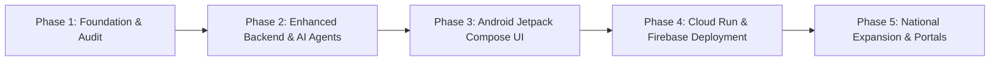

# KhataGuard AI — Engineering & Product Roadmap

**Project**: KhataGuard AI — India's State-Adaptive Property Intelligence Copilot  
**Team**: SwagCoders  
**Buildathon**: Google DeepMind × Google Cloud Startup Buildathon India 2026

---

## Phase Summary

---

## Detailed Milestones

### Phase 1: Foundation & Repository Audit (COMPLETED)
- [x] Full codebase audit and dependency resolution.
- [x] Core FastAPI backend setup with health endpoints.
- [x] Initial 120 sq. ft. discrepancy detection test passing.
- [x] Basic Android project setup and Gradle configuration.

### Phase 2: Local Backend Pipeline (PARTIALLY COMPLETE)
- [x] Implement modular Python pipeline tools (Google ADK runtime is not installed):
  - `normalization_tool.py`: Honorifics, dates, and unit conversions.
  - `consistency_tool.py`: Deterministic comparison engine.
  - `state_adapter_tool.py`: State adapter selector.
  - `report_agent.py`: Plain-language risk explanations.
  - `orchestrator.py`: Multi-agent pipeline coordinator.
- [x] Property Identity Graph service (`identity_graph.py`) with node/edge topology.
- [x] Professional Pre-Check PDF Report generated via ReportLab Platypus.
- [x] State Adapter enhancements for Karnataka, Maharashtra, and Tamil Nadu.
- [x] Backend unit tests for rules and mocked Gemini extraction. API integration suite needs runtime compatibility investigation; see `IMPLEMENTATION_STATUS.md`.

### Phase 3: Android Jetpack Compose Frontend (COMPLETED)
- [x] Replace all `BasicScreen` placeholders with polished Material 3 UI screens:
  - `WelcomeScreen`: App branding, feature pills, quick demo entry.
  - `LoginScreen`: UI exists; Firebase authentication is not wired.
  - `HomeScreen`: Dashboard with active cases, status, and quick actions.
  - `CreateCaseScreen`: Form validation with state chip selector.
  - `StateSelectionScreen`: State cards with portal details.
  - `UploadScreen`: Document management and demo document injectors.
  - `ProcessingScreen`: Step-by-step animated agentic workflow.
  - `ExtractedDetailsScreen`: Multilingual extraction field display.
  - `GraphScreen`: Visual Property Identity Graph.
  - `DiscrepancyScreen`: Color-coded findings with severity badges.
  - `EvidenceViewerScreen`: Side-by-side document evidence viewer.
  - `ReportScreen`: Report overview and PDF download action.
  - `HistoryScreen`: Case list with status.
  - `SettingsScreen`: Demo/Live mode toggle, backend endpoint, and privacy statement.
- [x] Full MVVM ViewModels with Coroutines and StateFlow.
- [x] Navigation Compose graph with argument passing.
- [ ] Verify complete offline Demo Mode flow across all Android screens.
- [x] Clean compilation verified via Gradle 8.7 and JDK 21.

### Phase 4: Cloud Deployment & Hardening (NEXT)
- [ ] Deploy containerized FastAPI backend to **Google Cloud Run**.
- [ ] Connect production **Cloud Firestore** for case persistence.
- [ ] Connect **Google Cloud Storage** for encrypted document uploads.
- [ ] Enable **Firebase Authentication** ID token validation in `security.py`.
- [ ] Set up **Google Cloud Secret Manager** for API keys.

### Phase 5: National Expansion & Partnerships (FUTURE)
- [ ] Add state adapters for Telangana (Dharani), Andhra Pradesh, Uttar Pradesh, and Delhi.
- [ ] Multi-lingual OCR fine-tuning for regional scripts (Telugu, Hindi, Bengali, Gujarati).
- [ ] Official API partnerships with state e-governance departments where sanctioned.
- [ ] Title insurance underwriting integration.
